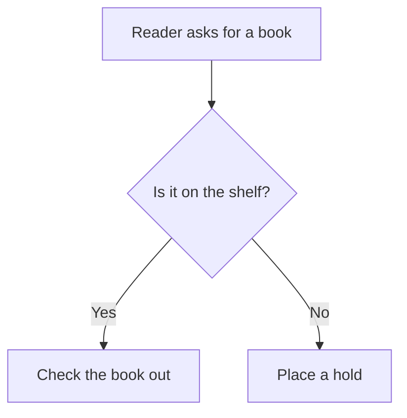
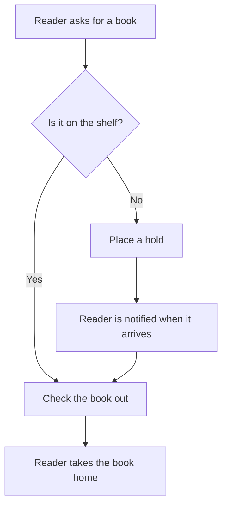

# Diagrams in Markdown

Outcome: you can put a live Mermaid
diagram inside a Markdown document —
so the source travels with the text
and the reader sees the picture — and
you know exactly which parts of that
story this guide verified and which
it only read about.

## The fence

A Mermaid diagram in Markdown is a
fenced code block whose language is
`mermaid`:

````markdown

````

A renderer that knows Mermaid draws
the picture in place of the code. A
renderer that does not shows the
source as ordinary code — which,
chapter 1 again, is still readable.
That graceful fall-back is unique to
diagram-as-code: a broken image link
shows nothing, a `mermaid` fence on an
unaware renderer shows the diagram's
text.

## GitHub

GitHub renders `mermaid` fences in
Markdown files, issues, and pull
requests. The diagram lives in the
same file as the prose, so a pull
request that changes a process shows
the text diff of its diagram beside
the text diff of the code — the review
story from chapter 1, working in the
tool teams already use. Two practical
notes, stated plainly because this
guide's lab did not push anything to
GitHub (the build rules forbid it, and
criteria.md lists this section as
documented-only where it must): the
render happens in the reader's
browser from the current Mermaid
version GitHub ships, so a diagram
can shift slightly when GitHub updates
it; and a syntax error shows GitHub's
error panel in place of the picture,
visible to every reader until the
source is fixed.

## MkDocs Material — including this site

MkDocs Material, the theme this
guide's own site uses, renders
`mermaid` fences when the site enables
its built-in Mermaid support (the
`pymdownx.superfences` extension with
the Mermaid custom fence, plus the
Mermaid JavaScript the theme loads).
This guide proves the point on its own
pages: the diagram below is not an
image file. It is a `mermaid` fence in
this chapter's source. The lab's strict
site build (criteria.md describes it)
emits this fence as a Mermaid block in
the page, and the theme's JavaScript
draws it in the reader's browser —
which is where you are seeing it, if
you are reading the built site:



One deployment fact, stated plainly:
that support is a setting, not a
default. This guide's `mkdocs.yml`
turns it on — a small
`pymdownx.superfences` block naming
the Mermaid custom fence, the one
deliberate addition to the series'
otherwise minimal site configuration —
and the lab verified the result in the
built HTML before this chapter claimed
it. On a build without that setting,
the same fence degrades to a readable
code block — the fall-back above —
and no content is lost either way.
That is the honest deploy story:
source always safe, picture where the
renderer provides one.

## Live diagram or image file?

Both, for different jobs. The fence
wins while a document is alive —
edited, reviewed, versioned — because
the diagram cannot drift from its
source. The rendered image file
(chapter 11) wins where the consumer
cannot run Mermaid: a slide deck, a
PDF produced elsewhere, an email. Many
projects keep the fence as the source
of truth and export images from it
when needed — which is only possible
because the text was the diagram all
along.

Check: add a `mermaid` fence with the
radio sequence from chapter 7 to any
Markdown file, and view it in a
renderer that supports Mermaid. If you
see participants and arrows, you have
this chapter. View the same file as
plain text: if you can still follow
the conversation, chapter 1's rule
just paid off again.
